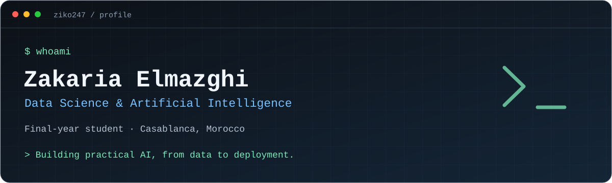

<div align="center">
<pre>
 _____       _                 _       
|__  / __ _ | | __ __ _  _ __ (_) __ _ 
  / / / _` || |/ // _` || '__|| |/ _` |
 / /_| (_| ||   <| (_| || |   | | (_| |
/____|\__,_||_|\_\\__,_||_|   |_|\__,_|
</pre>
</div>
```bash
# Initialize user session
zakaria@zephyrus-g16:~$ whoami
Zakaria El Mazghi
Location: Casablanca, MA
Status: 5th-Year AI & Data Engineering Student @ EMSI
Target: Automation AI Engineer / ML Engineer / Data Scientist
Next Milestone: PFE Internship or Master's in AI/ML (Initiating Feb 2027)

zakaria@zephyrus-g16:~$ cat ~/.workflow_philosophy
> 1. Read official documentation.
> 2. Consult structured tutorials only if docs are insufficient.
> 3. Implement code.
> Note: Technical architecture over fluff. Clear code comments required. Emojis strictly prohibited.
```
▓▓▓ LOG: SYSTEM HARDWARE & ENV ▓▓▓
```ini
[Host]
Machine=Asus ROG Zephyrus G16
CPU=Intel Core Ultra 9 285H
GPU=NVIDIA GeForce RTX 5070 Ti Laptop GPU
RAM=32 GB
Storage=1 TB SSD + NVMe SSD expansion

[Development_Environment]
OS=Windows 11 with WSL2 Ubuntu integration
Containers=Docker Desktop
Package_Managers=uv (Python), fnm (Node.js)
IDE=VS Code, PyCharm
```
▓▓▓ CONFIG: .wslconfig ▓▓▓
```ini
# Custom resource allocation for Docker / WSL2 backend
[wsl2]
memory=16GB
processors=10
swap=2GB
```
▓▓▓ DIRECTORY: /usr/local/skills/ ▓▓▓
```bash
zakaria@zephyrus-g16:~/skills$ tree .
.
├── ai_and_data
│   ├── Computer_Vision (OpenCV, MediaPipe)
│   ├── Predictive_Models (XGBoost, Keras LSTM)
│   ├── Retrieval (FAISS, RAG Architectures)
│   └── LLMs (Llama 3.2 via Ollama, OpenRouter Vision APIs)
├── backend_and_apis
│   ├── Python (FastAPI, Uvicorn)
│   └── JavaScript/TypeScript (Next.js 14 App Router, Node.js)
├── databases
│   ├── Graph (Neo4j)
│   ├── Relational (PostgreSQL, MySQL)
│   └── NoSQL/BaaS (MongoDB, Supabase, Firebase)
└── automation_and_infra
    ├── Workflows (n8n)
    └── Deployment (Docker, Vercel, GCP)
```
▓▓▓ LOG: EXECUTION HISTORY (EXPERIENCE) ▓▓▓
```yaml
# Recent professional deployments and internships
Devoteam:
  role: "AI/Data Engineering Intern"
  runtime: "Jul 2026 - Oct 2026"
  architecture: "Designed hybrid SOC alert triage automation pipeline. Integrated ML models, autonomous agents, FAISS vector retrieval, and Neo4j graph context via n8n and FastAPI."

Digrow:
  role: "Full-Stack Engineering Intern"
  runtime: "Oct 2026"
  architecture: "Developed AI-driven candidate document verification layer. Stack included Next.js 14, Supabase Storage, OpenRouter Vision APIs, Zod validation, and fuzzy string matching."

Scalax:
  role: "Frontend Developer Intern"
  runtime: "Jul 2025 - Sep 2025"
  architecture: "Built web application modules using React.js, Node.js, and MongoDB."
```
▓▓▓ LOG: ACTIVE/ARCHIVED PROJECTS ▓▓▓
```bash
zakaria@zephyrus-g16:~/projects$ ls -la
total 6
# Edge-AI tele-rehabilitation platform (HackAI UM6P '26)
drwxr-xr-x 2 zakaria root 4096 May 26 14:00 haraka_ai (MediaPipe, LLM summaries)

# Live sign language translator 
drwxr-xr-x 2 zakaria root 4096 Oct 26 09:15 sign_language_translator (Keras LSTM, Flet, local Llama 3.2)

# Applied data science focus
drwxr-xr-x 2 zakaria root 4096 Apr 26 11:22 flood_management_analysis (Statistical pipelines)

# Mobile backend for sports matching
drwxr-xr-x 2 zakaria root 4096 Apr 26 16:30 sports_recommendation_engine (Neo4j, MongoDB)

# Current R&D threads
drwxr-xr-x 2 zakaria root 4096 Nov 26 10:00 multimodal_rag_agent_architecture
drwxr-xr-x 2 zakaria root 4096 Nov 26 10:01 adaptive_ai_study_agent
```
▓▓▓ HARDWARE/REVERSE ENGINEERING LAB ▓▓▓
```python
def active_hardware_exploration():
    """
    Currently investigating custom driver interfaces on Windows hardware.
    Using Bluetooth Low Energy (BLE) packet sniffing to capture Apple Accessory 
    Protocol (AAP) commands, aiming to control AirPods Active Noise Cancellation (ANC) 
    modes directly through a custom Windows driver.
    """
    status = "In Progress"
    return status
```
▓▓▓ SYSTEM: OFFLINE PROCESSES (HOBBIES) ▓▓▓
```bash
zakaria@zephyrus-g16:~$ cat /proc/offline_tasks

[TASK 1: Physical Training (30% CPU Allocation)]
- Combat: Brazilian Jiu-Jitsu, MMA, Kickboxing.
- Conditioning: 80/20 Zone 2 base building (Strava tracked), 4x4 intervals.
- Strength: Zercher squats, Jefferson curls, Technogym isolations.

[TASK 2: Classical Piano]
- Focus: Polyphonic voicing, solo repertoire.
- Current memory buffer: Rachmaninoff, Chopin, Liszt (Liebestraum No. 3), Beethoven.

[TASK 3: Strategy]
- Logic: Regional Chess Tournaments.
- Render: PC Gaming (EA Sports FC).
```


<p align="center">
  
</p>


## About me

I'm **Zakaria Elmazghi**, a fifth-year **Data Science & AI student at LEMSI in Casablanca, Morocco**. I work mainly with Python, building machine learning pipelines, computer vision applications, and AI-powered workflows.

My internship and project experience spans cybersecurity alert triage, document verification, sign language recognition, and rehabilitation technology. I enjoy connecting models to usable applications and exploring how AI can solve concrete problems.

I'm interested in connecting with **engineering teams, employers, and developers** working on applied AI.

```text
ziko247@github:~$ cat focus.txt

  Core       Python · Machine Learning · Data Science
  Exploring  Multimodal RAG · AI Agents · Visual Reasoning
  Approach   Build → Evaluate → Improve
```

## Selected projects

<!-- Replace each example.com URL with a public repository, demo, or case study. -->

### Devoteam — Cybersecurity Alert Triage
**Internship · July–October 2026**

Built a hybrid alert triage system combining machine learning with automated agentic workflows to support cybersecurity alert analysis.

`Python` `XGBoost` `FAISS` `n8n` `FastAPI`

[Project / case study ↗](https://example.com/devoteam-project)

### Digrow — Document Verification & CV Builder
**Internship · October 2026**

Developed an AI-powered document verification pipeline and a real-time CV builder, combining vision LLMs and computer vision with a modern web application.

`Vision LLMs` `Computer Vision` `Next.js 14` `TypeScript` `React Hook Form` `Zod` `Supabase Storage`

[Project / case study ↗](https://example.com/digrow-project)

### Sign Language Translator
**May–October 2026**

Built a real-time web application for sign language translation using hand tracking and an LSTM gesture recognition model, with a local Llama 3.2 model running through Ollama.

`Flask` `SocketIO` `MediaPipe` `Keras` `LSTM` `Ollama`

[Repository / demo ↗](https://example.com/sign-language-project)

### Haraka.ai — Edge-AI Tele-rehabilitation
**HackAI · UM6P Benguerir · May 2026**

Built a tele-rehabilitation application that tracks 33 skeletal joint angles and compresses the resulting data into a **5 KB JSON payload**, paired with LLM-generated clinical summaries.

`MediaPipe Pose` `OpenCV` `Edge AI` `LLMs`

[Repository / demo ↗](https://example.com/haraka-project)

<details>
<summary><strong>Earlier experience — Scalax web modules</strong></summary>

**Internship · Scalax, a subsidiary of Reactivux · July–September 2025**

Developed web application modules using JavaScript, Node.js, React, MongoDB, HTML, and CSS.

[Project / case study ↗](https://example.com/scalax-project)

</details>

## Currently building

| Project | Focus |
| :--- | :--- |
| **Multimodal RAG Agent** | Ingesting, retrieving, and reasoning across text, images, and diagrams. |
| **Adaptive Study Agent** | Adapting curriculum difficulty and explanations to a student's current knowledge. |
| **Visual AI System** | Exploring real-time visual reasoning and inference. |

## Tools I work with

| Area | Technologies used across my projects |
| :--- | :--- |
| **Machine learning** | Python, XGBoost, Keras, LSTM models |
| **Computer vision** | OpenCV, MediaPipe, vision LLMs |
| **Retrieval & AI workflows** | FAISS, Ollama, Llama 3.2, n8n |
| **APIs & real-time applications** | FastAPI, Flask, SocketIO |
| **Web development** | React, Next.js, TypeScript, JavaScript, Node.js |
| **Data & storage** | MongoDB, Supabase Storage |

## Let's connect

<!-- TODO: Replace these placeholders with your public links. -->

[LinkedIn](https://example.com/your-linkedin) · [Portfolio](https://example.com/your-portfolio) · [Email](mailto:your-email@example.com)

I'm happy to discuss applied AI projects, exchange ideas, and collaborate with other developers.

---

```text
ziko247@github:~$ exit
Outside of programming: a little piano, a little chess. ♫ ♟
```
